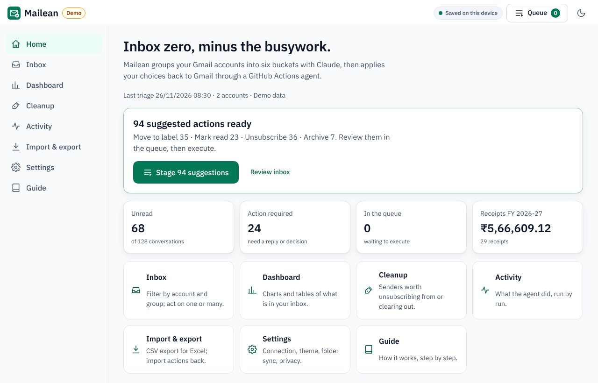
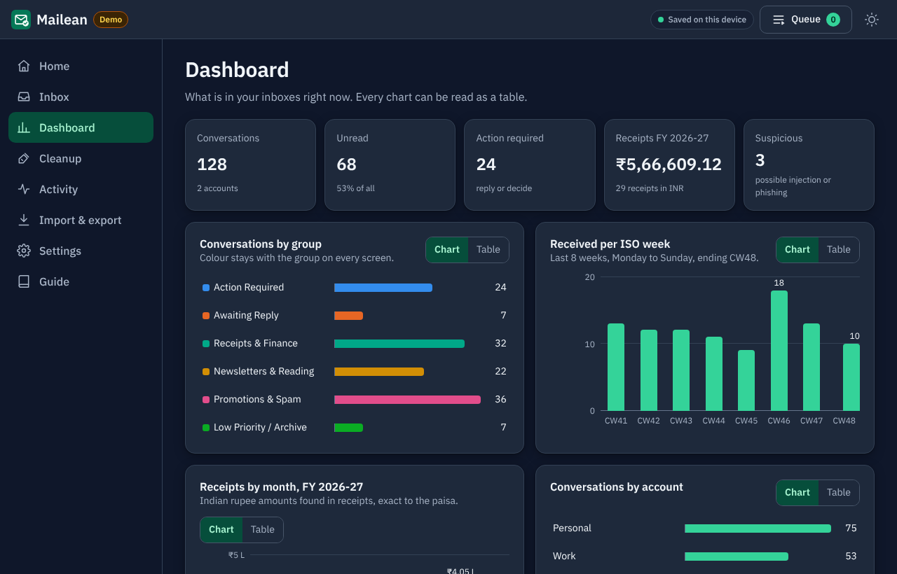
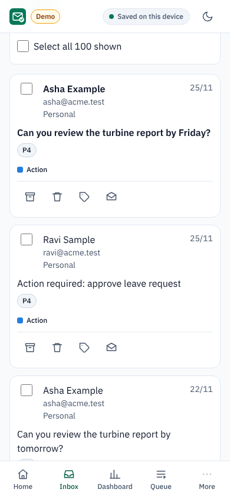

# Mailean: inbox zero, minus the busywork

Version 1.0.0 · 26/11/2026 · MIT licence

Mailean sorts every Gmail account you own into six clear groups. You act on hundreds of emails at once from one dashboard, on your laptop or phone.

**Live dashboard:** https://sathyanarayanan-2001.github.io/mailean/ (goes live after step 6 below; not yet checked, because it does not exist until you deploy).



| Dashboard, dark theme | Inbox on a phone |
|---|---|
|  |  |

All screenshots use the made-up demo inbox.

## What it does

- **Triage.** Every 4 hours a GitHub Actions job reads new inbox metadata from each Gmail account. Claude (`claude-sonnet-5-5`, structured outputs) places each conversation in one of six groups: Action Required, Awaiting Reply, Receipts & Finance, Newsletters & Reading, Promotions & Spam, Low Priority / Archive. It also writes a one-line summary, a priority from 1 to 5 and a suggested action.
- **Act in bulk.** Tick conversations, or accept Claude's suggestions, and queue Archive, Trash, Move to label, Mark read, Star, Unsubscribe or Trash all from sender. Press **Execute via agent**. A second workflow applies the actions to Gmail and reports back.
- **Dashboard.** Counts by group, ISO week (CW48), account and priority, plus receipts per month in the financial year (FY 2026-27). Every chart has a Table view.
- **Cleanup.** Noisy senders are listed with counts and the age of their oldest message.
- **Excel round trip.** Export the inbox to CSV, fill in an Action column, and import it back as queued actions. Every row gets a status in a preview first.
- **Works offline.** It installs as an app on phones and laptops. The last inbox you loaded stays readable with no connection.
- **Folder sync (optional).** Your queue, labels and history stay in step across computers through a OneDrive folder.

## How it works

```
 Gmail accounts ──(gmail.modify, refresh tokens in Secrets)──┐
                                                               ▼
 Private repo "gmail-command-center"  ── Actions ──►  agent/sync_inbox.py ──► Claude API
   │  secrets: MAILEAN_ACCOUNTS, ANTHROPIC_API_KEY             │
   │  branch mailean-state: inbox.json, audit/*.json  ◄────────┘
   │                                                   agent/execute_commands.py ◄── run-commands.yml
   ▼                                                                                   ▲
 GitHub REST API (your fine-grained token, stored in your browser only)                │
   ▲                                                                                   │
 Public repo "mailean" ── GitHub Pages ──► dashboard (docs/) ── "Execute via agent" ───┘
```

Read [docs/ARCHITECTURE.md](docs/ARCHITECTURE.md) for the design, data shapes and Big-O figures.

## Privacy

- Email data lives only in **your private repository**, on the `mailean-state` branch. Each sync replaces that branch with a single commit, so old subjects do not pile up in git history.
- The public dashboard repository holds code only. The page asks for your token. It refuses to load data from a repository that is public.
- Only the sender, subject, labels and a 300-character snippet go to Claude, never full bodies. Snippets are **not** stored unless you opt in. Digits that look like one-time codes are masked.
- Email text is treated as untrusted data. Claude only labels and summarises. Only actions **you** queue are ever executed.
- The page talks only to `api.github.com`. There are no analytics, no other servers and no third-party scripts (Content Security Policy enforced).
- Optional: set `MAILEAN_STATE_PASSPHRASE` to encrypt the state file (AES-256-GCM).

Read [SECURITY.md](SECURITY.md) for the threat model.

## Getting started

The full guide is [docs/SETUP.md](docs/SETUP.md) (about 30 minutes). In short:

1. Enable the Gmail API in Google Cloud, and create a **Desktop app** OAuth client.
2. Run `python scripts/setup_oauth.py --client-secret-file client_secret.json` and sign in to each Gmail account.
3. Create a **private** repository `gmail-command-center`, upload these files, and add the secrets `MAILEAN_ACCOUNTS` and `ANTHROPIC_API_KEY` and the variable `MAILEAN_ROLE` = `data`.
4. Run the **Scheduled triage** workflow once.
5. Create a fine-grained token for that repository only (Contents: read; Actions: read and write).
6. Create a **public** repository `mailean`, upload the same files, and set **Settings → Pages → Source** to **GitHub Actions**.
7. Open the dashboard, enter `owner/gmail-command-center` and the token, and press **Connect**.

Want to look first? Open the dashboard and press **Try the demo**. It uses a made-up inbox of 128 conversations.

## Develop and test

```bash
python -m venv .venv && . .venv/bin/activate        # Windows: .venv\Scripts\activate
python -m pip install --require-hashes -r requirements-dev.txt
npm ci
python -m pytest tests/python        # agent: 80 tests
npm test                             # dashboard logic: 27 tests
python scripts/eval_golden.py        # five golden examples (adds Claude if ANTHROPIC_API_KEY is set)
python -m playwright install chromium && python -m pytest tests/e2e   # browser: 14 tests
python -m http.server -d docs 8000   # then open http://localhost:8000
```

## Repository layout

```
mailean/
├── .github/
│   ├── workflows/ci.yml                # tests on every push and PR; deploys Pages from main
│   ├── workflows/scheduled-triage.yml  # cron every 4 hours -> agent/sync_inbox.py
│   ├── workflows/run-commands.yml      # workflow_dispatch(commands_payload) -> agent/execute_commands.py
│   ├── dependabot.yml
│   └── pull_request_template.md
├── agent/                 # Python agent (the "src" of the backend)
│   ├── sync_inbox.py      # fetch, triage, write state
│   ├── execute_commands.py# apply queued actions, write audit
│   ├── classify.py        # Claude structured outputs + rule fallback + injection defences
│   ├── commands.py        # strict payload validation
│   ├── gmail.py  http.py  # Gmail REST client, timeouts, backoff, quota pacing
│   ├── state.py  publish.py  sanitize.py  money.py  config.py
├── docs/                  # GitHub Pages site (the "src" of the frontend) and documents
│   ├── index.html  app.js  styles.css  sw.js  manifest.webmanifest  theme-init.js
│   ├── js/                # format, csv, merge, model, commands, store, sync, github, crypto, charts, dom, exporter, worker
│   ├── fonts/  icons/  screenshots/  demo-state.json
│   ├── SETUP.md  ARCHITECTURE.md  QUALITY.md
├── scripts/               # setup_oauth.py, eval_golden.py, make_demo_state.py, make_oracles.py, fakes.py
├── tests/                 # python/, js/, e2e/, fixtures/
├── requirements.in / requirements.txt (hash-locked) · requirements-dev.in / requirements-dev.txt
├── package.json · package-lock.json · pyproject.toml
└── README.md · CHANGELOG.md · CONTRIBUTING.md · SECURITY.md · LICENSE · .gitignore · .editorconfig
```

## Revision history

See [CHANGELOG.md](CHANGELOG.md). Current: **1.0.0, 26/11/2026**, first release.

## Licence

MIT. See [LICENSE](LICENSE). IBM Plex Sans is under the SIL Open Font License 1.1.
